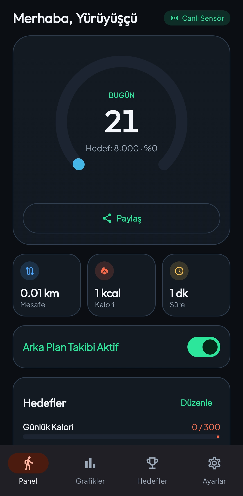

# Stepmeter

-3DDC84?logo=android&logoColor=white>)


**Stepmeter**, tamamen cihaz üzerinde çalışan, hiçbir üçüncü taraf sunucuya veya bulut servisine veri göndermeyen; arka planda donanım adım sensörü (`SensorManager`) ile gerçek zamanlı adım takibi, mesafe/kalori hesaplaması, aylık ve son 30 günlük grafik analizi, hedef bildirimleri ve sıkıştırılmış + uçtan uca şifreli yerel CSV yedekleme sunan modern bir Android adımsayar uygulamasıdır.

---

## Ekran Görüntüleri

|                  Kontrol Paneli                   |        Hedefler                         |            Ayarlar                        |
| :-----------------------------------------------: | :-------------------------------------: | :---------------------------------------: |
|  |  |  |

---

## Temel Özellikler

- **Arka Planda Gerçek Zamanlı Adım Takibi (`SensorManager` + Health Foreground Service):**
  - `Sensor.TYPE_STEP_COUNTER` (ve desteklenmeyen cihazlarda `TYPE_STEP_DETECTOR` yedeği) üzerinden `android:foregroundServiceType="health"` ön plan servisiyle uygulama kapalıyken bile kesintisiz adım sayımı.
  - Cihaz yeniden başlatmalarına ve gece yarısı gün değişimlerine dayanıklı taban çizgisi (baseline) yönetimi.
  - Pil ve disk ömrünü korumak için bellek içi adım tamponlama (15 adım / 10 saniye aralıklı yazma ve servis durduğunda anında kaydetme).
- **Kişiselleştirilmiş Mesafe ve Kalori Hesabı:**
  - Boy, kilo ve isteğe bağlı özel adım uzunluğu değerlerine göre otomatik mesafe (`km`), yakılan kalori (`kcal`) ve aktif süre (`dk`) hesaplaması.
- **Son 30 Gün ve Aylık İlerleme Grafikleri:**
  - Jetpack Compose `Canvas` ile çizilmiş animasyonlu adım halkası, dokunmatik çubuk + trend çizgili sütun grafiği ve Adım / Mesafe / Kalori filtreleri.
  - Gece Modu, Gündüz Modu ve Sistem teması desteği; tablet ve katlanabilir cihazlara uyumlu `NavigationBar` / `NavigationRail` düzeni.
- **Günlük, Haftalık ve Aylık Hedefler + Uygulama İçi Bildirimler:**
  - Esnek adım/kalori hedefleri oluşturma; hedef tamamlandığında tekil dönem anahtarıyla çoğaltmasız kutlama bandı ve bildirim geçmişi.
- **GZIP Sıkıştırmalı & AES-256-GCM Şifreli Yerel CSV Yedekleme:**
  - Tüm profil ayarları, hedefler ve aktivite geçmişi GZIP ile sıkıştırılıp **AES-256-GCM** (Android Keystore veya taşınabilir parola bazlı PBKDF2) ile şifrelenerek yalnızca cihaz hafızasında (`filesDir/backups/*.csv.enc`) saklanır.
  - Storage Access Framework (SAF) ile ek depolama izni istemeden `.csv.enc` dışa aktarma ve geri yükleme.
- **İlerleme Kartı Paylaşımı & Şifreli Yerel Geri Bildirim:**
  - Günlük/haftalık ilerleme özetini tema seçilebilir yüksek çözünürlüklü PNG kart olarak oluşturup Android `FileProvider` ile paylaşma.
  - Geri bildirimleri Keystore ile şifreli olarak cihazda saklama veya e-posta taslağı açma.

---

## Gizlilik, Güvenlik ve Performans

- **Sıfır Ağ İzni:** `AndroidManifest.xml` içinde `INTERNET` izni yoktur; veriler cihaz dışına çıkmaz.
- **Bulut Yedekleme Devre Dışı:** `android:allowBackup="false"` ile otomatik bulut senkronizasyonu engellenir.
- **İndeksli Yerel Veritabanı:** Room tablolarında `epochDay`, `yearMonth`, `updatedAt`, `(periodType, metricType)` ve `(goalId, periodKey)` indeksleri kullanılır; hedef değerlendirmeleri tek aralıklı SQLite taramasıyla yapılır.
- **Optimizasyon Raporu:** Yapılan performans iyileştirmelerinin ayrıntıları için [`OPTIMIZATIONS.md`](OPTIMIZATIONS.md) dosyasına göz atabilirsiniz.

---

## Son Kullanıcı Kurulumu (Android Release APK)

Uygulamayı Android cihazınıza doğrudan **GitHub Releases** üzerinden APK ile kurabilirsiniz:

1. Depodaki [**Releases**](../../releases) sayfasını açın ve en güncel sürümün altından `Stepmeter-v*.apk` (veya `app-release.apk`) dosyasını indirin.
2. İndirilen `.apk` dosyasına dokunun. Android ilk kez mağaza dışı kurulum yapıyorsanız **"Bilinmeyen uygulamalardan yükle"** (Install unknown apps) iznini açmanızı isteyecektir; tarayıcınız veya dosya yöneticiniz için onay verin.
3. **Yükle** butonuna dokunup kurulumu tamamlayın.
4. Uygulamayı ilk kez açtığınızda aşağıdaki izinleri onaylayın:
   - **Fiziksel Aktivite (`ACTIVITY_RECOGNITION`):** Donanımsal adım sensörünün okuyabilmesi için gereklidir.
   - **Bildirimler (`POST_NOTIFICATIONS`):** Arka planda canlı takip bildirimini göstermek için gereklidir.
5. _(Önerilen)_ Cihaz üreticinizin agresif pil kısıtlaması varsa **Ayarlar > Uygulamalar > Stepmeter > Pil** bölümünden **Kısıtlanmamış** seçeneğini seçin.

---

## Manuel Release APK Oluşturma Rehberi

Kendi imzalı Release APK dosyanızı yerel ortamda üretmek için `app/build.gradle.kts` içinde tanımlı `release` imzalama yapılandırmasını kullanabilirsiniz:

### 1. İmza Anahtarı (Keystore) Oluşturun

Proje kök dizininde `upload` alias'ı ile bir `.jks` anahtarı üretin:

```bash
keytool -genkey -v \
  -keystore my-upload-key.jks \
  -keyalg RSA -keysize 2048 -validity 10000 \
  -alias upload
```

_(Oluşturduğunuz `my-upload-key.jks` dosyasını ve parolalarınızı kesinlikle Git deposuna commit'lemeyin.)_

### 2. Ortam Değişkenlerini Tanımlayın ve Derleyin

`app/build.gradle.kts`, imza ayarlarını `KEYSTORE_PATH` (varsayılan: `my-upload-key.jks`), `STORE_PASSWORD` ve `KEY_PASSWORD` ortam değişkenlerinden okur:

```bash
export KEYSTORE_PATH="$(pwd)/my-upload-key.jks"
export STORE_PASSWORD="depo-parolaniz"
export KEY_PASSWORD="anahtar-parolaniz"

# İmzalı Release APK derleyin
./gradlew assembleRelease
```

Sistem Gradle'ı kullanıyorsanız:

```bash
gradle assembleRelease
```

Derleme tamamlandığında imzalı APK şu konumda oluşturulur:

```text
app/build/outputs/apk/release/app-release.apk
```

---

## Geliştiriciler İçin Kurulum

### Gereksinimler

- **JDK 17+** (Gradle derleme aracı için)
- **Android SDK 36** (`minSdk = 24`, `targetSdk = 36`, `compileSdk = 36`)
- **Android Studio** (AGP 9.x / Kotlin Compose uyumlu)

### Adım Adım Geliştirme Ortamı

```bash
# 1. Depoyu klonlayın
git clone https://github.com/<kullanici-adi>/stepmeter.git
cd stepmeter

# 2. Debug APK derleyin (veya projeyi Android Studio ile açın)
./gradlew assembleDebug

# 3. Birim ve Robolectric testlerini çalıştırın
./gradlew :app:testDebugUnitTest
```

> **Not:** Ortamınızda `./gradlew` yerine sistem Gradle kuruluysa tüm komutları doğrudan `gradle assembleDebug` ve `gradle :app:testDebugUnitTest` şeklinde çalıştırabilirsiniz.

### Kullanılan İzinler

| İzin                                                               | Kullanım Amacı                                         |
| :----------------------------------------------------------------- | :----------------------------------------------------- |
| `ACTIVITY_RECOGNITION` _(Android 10+)_                             | Donanım adım sensörünü gerçek zamanlı okumak için      |
| `FOREGROUND_SERVICE` & `FOREGROUND_SERVICE_HEALTH` _(Android 14+)_ | Arka planda kesintisiz sağlık/adım sayımı servisi için |
| `POST_NOTIFICATIONS` _(Android 13+)_                               | Canlı takip ön plan bildirimini göstermek için         |

---

## Proje Yapısı

```text
app/src/main/java/com/example/
├── MainActivity.kt                  # Navigation Compose, kenarsız UI ve izin akışı
├── di/StepmeterContainer.kt         # Manuel bağımlılık kapsayıcısı
├── domain/                          # DateUtils, MetricsCalculator, FormatUtils, Models
├── security/CryptoManager.kt        # Android Keystore & PBKDF2 + AES-256-GCM şifreleme
├── data/                            # Room (Entities, Daos, AppDatabase), DataStore, Repository, BackupManager
├── sensor/                          # StepSensorTracker & StepCounterForegroundService
├── share/ProgressCardRenderer.kt    # 1080x1350 PNG özet kartı üretimi ve FileProvider paylaşımı
└── ui/                              # Theme, MainViewModel, MotionAndCharts ve 5 Compose ekranı
```

---

## Lisans

Bu proje **MIT Lisansı** altında lisanslanmıştır. Ayrıntılar için [`LICENSE`](LICENSE) dosyasını inceleyebilirsiniz.
