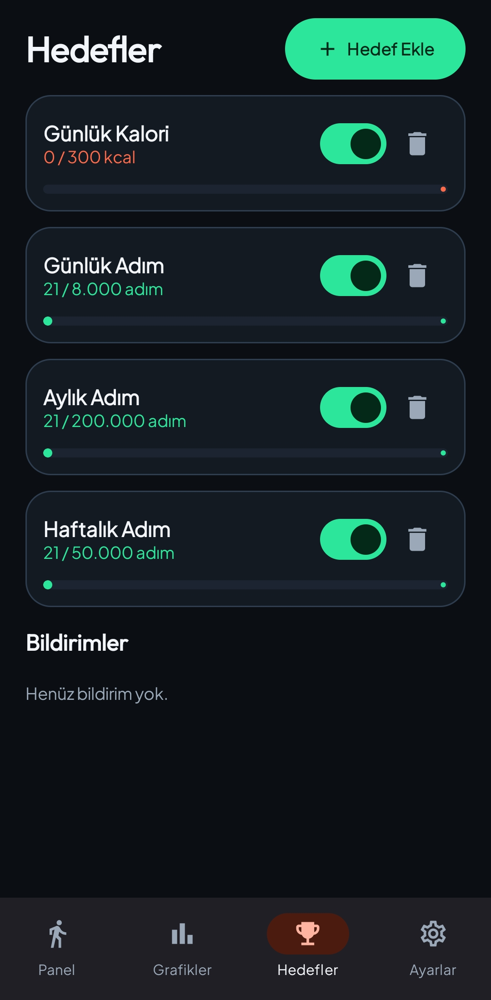
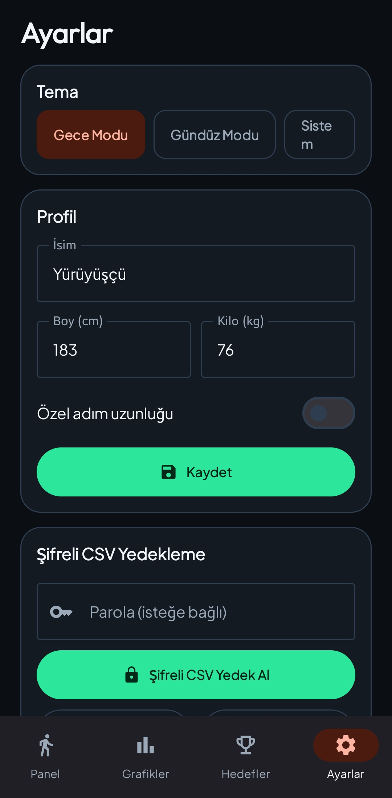

# Stepmeter

Stepmeter, verisini yalnızca cihazda tutan bir Android adımsayar uygulamasıdır. Adımları donanım sensöründen arka planda sayar, mesafe ve kalori hesaplar, günlük ve aylık grafikler çizer, hedef tamamlandığında bildirim gösterir. Uygulamanın internet izni yoktur. Yedekler cihazda sıkıştırılıp şifrelenerek saklanır.

-3DDC84?logo=android&logoColor=white)


## Ekran görüntüleri

| Kontrol paneli | Hedefler | Ayarlar |
| :---: | :---: | :---: |
|  |  |  |

## Özellikler

### Adım takibi

- Adımlar `Sensor.TYPE_STEP_COUNTER` ile sayılır. Cihaz bu sensörü desteklemiyorsa `TYPE_STEP_DETECTOR` yedek olarak devreye girer.
- Sayım `health` türünde bir ön plan servisinde (`foregroundServiceType="health"`) çalışır, bu yüzden uygulama kapalıyken de sürer.
- Taban çizgisi (baseline) yönetimi, cihazın yeniden başlatılmasını ve gece yarısı gün değişimini hesaba katar.
- Pil ve disk kullanımını azaltmak için adımlar önce bellekte tamponlanır, 15 adım / 10 saniye eşiğinde diske yazılır. Servis durduğunda tampondaki adımlar hemen kaydedilir.

### Mesafe ve kalori

Boy, kilo ve isteğe bağlı özel adım uzunluğu girildiğinde mesafe (km), yakılan kalori (kcal) ve aktif süre (dk) otomatik hesaplanır.

### Grafikler ve arayüz

- Son 30 gün ve aylık görünümler.
- Jetpack Compose `Canvas` ile çizilmiş animasyonlu adım halkası ve dokunmatik çubuk grafiği (trend çizgili). Grafikler adım, mesafe ve kalori için filtrelenebilir.
- Açık, koyu ve sistem teması.
- Tablet ve katlanabilir cihazlarda `NavigationBar` yerine `NavigationRail` kullanılır.

### Hedefler ve bildirimler

- Günlük, haftalık ve aylık adım veya kalori hedefleri tanımlanabilir.
- Hedef tamamlandığında uygulama içinde bir kutlama bandı ve bildirim görünür. Her dönem için tekil bir anahtar tutulduğundan aynı hedef için ikinci kez bildirim gelmez. Geçmiş bildirimler listelenir.

### Yedekleme

- Profil ayarları, hedefler ve aktivite geçmişi CSV olarak dışa aktarılır, GZIP ile sıkıştırılır ve AES-256-GCM ile şifrelenir.
- Şifreleme anahtarı Android Keystore'dan ya da, yedeğin başka cihaza taşınabilmesi için, parolaya dayalı PBKDF2 ile türetilir.
- Yedekler `filesDir/backups/*.csv.enc` altında saklanır.
- Storage Access Framework (SAF) sayesinde ek depolama izni istenmeden `.csv.enc` dosyası dışa aktarılabilir ve geri yüklenebilir.

### Paylaşım ve geri bildirim

- Günlük veya haftalık özet, seçilen temayla 1080x1350 PNG kart olarak üretilir ve `FileProvider` ile paylaşılır.
- Geri bildirimler Keystore ile şifrelenip cihazda saklanır ya da e-posta taslağı olarak açılır.

## Gizlilik, güvenlik ve performans

- `AndroidManifest.xml` içinde `INTERNET` izni yoktur. Veriler cihazdan çıkmaz.
- `android:allowBackup="false"` ayarı, verilerin otomatik bulut yedeğine gitmesini engeller.
- Room tablolarında `epochDay`, `yearMonth`, `updatedAt`, `(periodType, metricType)` ve `(goalId, periodKey)` indeksleri vardır. Hedef değerlendirmeleri tek aralıklı bir SQLite taramasıyla yapılır.

## Kurulum

### APK ile kurulum

1. [Releases](https://github.com/Shynobisuikast/Stepmeter/releases/latest) sayfasından en güncel sürümün dosyasını indirin.
2. Dosyaya dokunun. Android mağaza dışı kurulum için izin isterse, kullandığınız tarayıcı veya dosya yöneticisi için "Bilinmeyen uygulamalardan yükle" iznini verin.
3. Kurulumu tamamlayın ve uygulamayı açın.
4. İlk açılışta aşağıdaki izinleri onaylayın:
   - Fiziksel aktivite (`ACTIVITY_RECOGNITION`): adım sensörünü okumak için gerekir.
   - Bildirimler (`POST_NOTIFICATIONS`): canlı takip bildirimini göstermek için gerekir.
5. Üreticiniz agresif pil kısıtlaması uyguluyorsa Ayarlar > Uygulamalar > Stepmeter > Pil bölümünden "Kısıtlanmamış" seçeneğini seçin. Aksi halde sistem arka plandaki sayımı durdurabilir.

### Kaynaktan derleme

Gereksinimler:

- JDK 17 veya üzeri
- Android SDK 36 (`minSdk = 24`, `targetSdk = 36`, `compileSdk = 36`)
- Android Studio (AGP 9.x ve Kotlin Compose ile uyumlu bir sürüm)

```bash
# Depoyu klonlayın
git clone https://github.com/Shynobisuikast/Stepmeter.git
cd Stepmeter

# Debug APK derleyin (ya da projeyi Android Studio ile açın)
./gradlew assembleDebug

# Birim ve Robolectric testlerini çalıştırın
./gradlew :app:testDebugUnitTest
```

Sisteminizde Gradle wrapper yerine kurulu Gradle varsa komutları `gradle assembleDebug` ve `gradle :app:testDebugUnitTest` olarak çalıştırabilirsiniz.

### İmzalı release APK üretme

`app/build.gradle.kts` içindeki `release` imza yapılandırması, bilgileri ortam değişkenlerinden okur.

1. Proje kök dizininde bir anahtar dosyası oluşturun:

   ```bash
   keytool -genkey -v \
     -keystore my-upload-key.jks \
     -keyalg RSA -keysize 2048 -validity 10000 \
     -alias upload
   ```

   `my-upload-key.jks` dosyasını ve parolalarınızı Git deposuna eklemeyin.

2. Ortam değişkenlerini tanımlayıp derleyin. `KEYSTORE_PATH` verilmezse `my-upload-key.jks` kullanılır.

   ```bash
   export KEYSTORE_PATH="$(pwd)/my-upload-key.jks"
   export STORE_PASSWORD="depo-parolaniz"
   export KEY_PASSWORD="anahtar-parolaniz"

   ./gradlew assembleRelease
   ```

   APK `app/build/outputs/apk/release/app-release.apk` konumunda oluşur.

## İzinler

| İzin | Neden gerekli |
| --- | --- |
| `ACTIVITY_RECOGNITION` (Android 10+) | Adım sensörünü okumak için |
| `FOREGROUND_SERVICE` ve `FOREGROUND_SERVICE_HEALTH` (Android 14+) | Arka planda adım sayan servisi çalıştırmak için |
| `POST_NOTIFICATIONS` (Android 13+) | Canlı takip bildirimini göstermek için |

## Proje yapısı

```
app/src/main/java/com/example/
├── MainActivity.kt                  # Navigation Compose, kenarsız arayüz, izin akışı
├── di/StepmeterContainer.kt         # Elle yazılmış bağımlılık kapsayıcısı
├── domain/                          # DateUtils, MetricsCalculator, FormatUtils, modeller
├── security/CryptoManager.kt        # Android Keystore, PBKDF2 ve AES-256-GCM şifreleme
├── data/                            # Room (Entity, Dao, AppDatabase), DataStore, Repository, BackupManager
├── sensor/                          # StepSensorTracker ve StepCounterForegroundService
├── share/ProgressCardRenderer.kt    # 1080x1350 PNG özet kartı ve FileProvider paylaşımı
└── ui/                              # Tema, MainViewModel, MotionAndCharts ve 5 Compose ekranı
```

## Lisans

Bu proje MIT Lisansı ile dağıtılır. Ayrıntılar için [LICENSE](LICENSE) dosyasına bakın.
